<div align="center">
  
  <h1>chat</h1>
  <p><em>Open-source, self-hostable T3 Chat built on SvelteKit + Convex.</em></p>

  <p>
    
    
    
    
    
  </p>
</div>

---

## ℹ️ About

**chat** is an open-source alternative/clone of [T3 Chat](https://t3.chat/), originally built for [Theo's cloneathon](https://x.com/theo/status/1931515264497254402).

This version is wired to the **[OpenCode Go](https://opencode.ai) model gateway** (an OpenAI-compatible endpoint) and ships a curated set of frontier **reasoning models**. It is fully self-hostable: bring your own Convex instance, auth provider, and model-gateway key.

> While it is a clone, the feature set is not identical to T3 Chat.

## ✨ Features

### 🤖 AI & Models
- **Curated frontier reasoning models** served through the OpenCode Go gateway
- **Live reasoning display** — watch the model "think" as it streams (`reasoning_content` / `reasoning`)
- **Real-time token streaming** with server-side streaming so chats survive reloads
- **Bring Your Own Key** — users can supply their own gateway key for unlimited use

### 💬 Chat Experience
- **Conversation branching** to explore different paths from any message
- **Auto-generated conversation titles**
- **Cursor-like rules** for consistent assistant behavior
- **Full-text search** across your chat history
- **Privacy mode** for safe screen sharing

### 🧩 Rich Content
- **Image uploads** (multimodal where supported)
- **Web search** integration for up-to-date answers
- **Markdown rendering** with syntax highlighting (Shiki) and sanitization
- **Citations / annotations** (URL citations) rendered inline
- **Enhance prompt** to polish rough prompts before sending

### ⚙️ Productivity
- **Keyboard shortcuts** for power users
- **Message regeneration**
- **Light / dark theme** with system preference detection

## 🛠️ Tech Stack

<table>
<tr>
<td>

**Frontend**
- 🔥 SvelteKit + TypeScript
- 🎨 Tailwind CSS + tailwind-variants
- 🍨 Melt UI / Bits UI components
- 🌗 mode-watcher (theme)

</td>
<td>

**Backend & Infra**
- 🔧 Convex (database + serverless functions)
- 🔐 Better Auth (GitHub OAuth)
- 🤖 OpenCode Go gateway (OpenAI-compatible)
- ▲ Deployed on Vercel (`@sveltejs/adapter-vercel`)

</td>
</tr>
</table>

## 🚀 Quick Start

### Prerequisites
- Node.js 18+
- pnpm
- A [Convex](https://www.convex.dev/) account
- An [OpenCode Go](https://opencode.ai) API key (or any OpenAI-compatible key)
- A GitHub OAuth app (for login)

### Installation

1. **Clone the repository**
   ```bash
   git clone https://github.com/tglide/thom-chat.git
   cd thom-chat
   ```

2. **Install dependencies**
   ```bash
   pnpm install
   ```

3. **Configure environment**
   ```bash
   cp .env.example .env
   # Fill in the values — see the table below
   ```

4. **Start Convex and the dev server** (Convex writes `PUBLIC_CONVEX_URL` into `.env.local`)
   ```bash
   pnpm dev
   ```
   This runs `convex dev` and `vite dev` together.

5. **Open the app**
   ```
   http://localhost:5173
   ```

### Environment Variables

| Variable | Required | Description |
| --- | --- | --- |
| `OPENCODE_API_KEY` | ✅ | OpenCode Go (or OpenAI-compatible) gateway key, used server-side. Falls back to `OPENROUTER_FREE_KEY` if unset. |
| `BETTER_AUTH_SECRET` | ✅ | Secret used to sign Better Auth sessions. Generate a long random string. |
| `GITHUB_CLIENT_ID` | ✅ | GitHub OAuth app client id. |
| `GITHUB_CLIENT_SECRET` | ✅ | GitHub OAuth app client secret. |
| `BETTER_AUTH_URL` | ⬜ | Public base URL of the deployment (e.g. `https://your-app.vercel.app`). |
| `PUBLIC_CONVEX_URL` | ⚙️ | Set automatically by `convex dev` into `.env.local`. |

> 🔒 All secrets above live in environment variables / Vercel project settings — **none are committed to the repository**.

## 🤝 Contributing

Contributions are welcome!

1. Fork the repository
2. Create your feature branch (`git checkout -b feature/amazing-feature`)
3. Commit your changes (`git commit -m 'Add amazing feature'`)
4. Push to the branch (`git push origin feature/amazing-feature`)
5. Open a Pull Request

## 📄 License

This project is licensed under the MIT License — see the [LICENSE](LICENSE) file for details.

## 🙏 Acknowledgments

- Inspired by [T3 Chat](https://t3.chat/)
- Originally created by [Thomas G. Lopes](https://github.com/tglide) and [Aidan Blesar](https://github.com/ieedan)
- Built with [SvelteKit](https://kit.svelte.dev/), [Convex](https://convex.dev/), and [Better Auth](https://better-auth.com/)
- Models served via [OpenCode](https://opencode.ai/)

---

<div align="center">
  <p>Made with ❤️ — a personal project / portfolio piece.</p>
</div>
